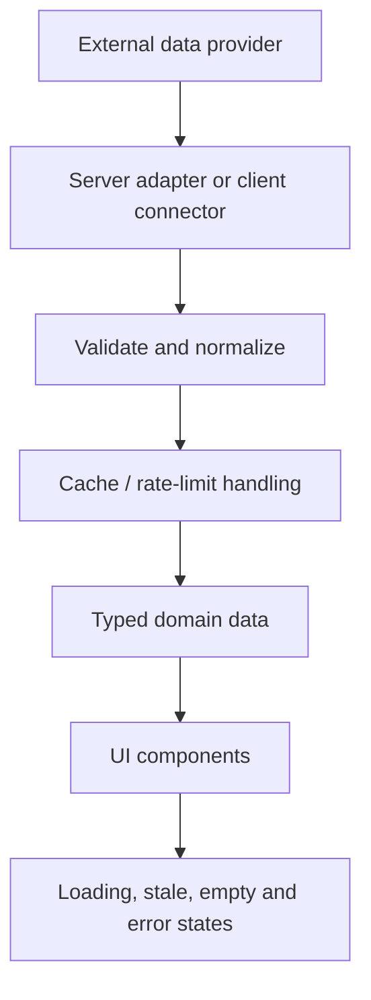

# Arsitektur Zabrina Alpha Terminal

## Tujuan

Menjaga aplikasi terminal multi-aset tetap modular, dapat diuji, dan transparan tentang asal serta kualitas data. Dokumen ini menggambarkan arah arsitektur; struktur aktual tiap modul tetap mengikuti kode pada branch aktif.

## Lapisan aplikasi

1. **Route dan layout — `app/`**: routing Next.js App Router, metadata, dan komposisi halaman.
2. **Komponen fitur — `components/`**: UI chart, watchlist, kalender, berita, dan widget yang digunakan ulang.
3. **Adapter data — `lib/` atau modul domain sejenis**: komunikasi HTTP/WebSocket, parsing, validasi, cache, dan normalisasi.
4. **State client**: gunakan Zustand hanya untuk state yang perlu dibagikan antar komponen; state server/data fetching tidak otomatis perlu dipindahkan ke store global.
5. **Sumber eksternal**: Binance public market data, widget TradingView, dataset World Bank, dan feed berita sesuai integrasi yang benar-benar tersedia.

## Aliran data yang disarankan

Respons eksternal harus diperlakukan sebagai input yang tidak tepercaya. Validasi tipe, rentang angka, simbol, timestamp, dan bentuk respons sebelum data digunakan oleh komponen.

## Chart dan streaming

- Default produk: `BTCUSDT`, timeframe `4H`, target historis hingga 600 candle.
- Normalisasi candle ke urutan waktu naik dan hindari duplikasi timestamp.
- Tampilkan timestamp dalam zona waktu yang eksplisit; jangan mencampur detik dan milidetik.
- Tangani disconnect, reconnect dengan backoff, dan cleanup subscription saat komponen dilepas.
- Batasi koneksi per simbol/timeframe; jangan membuat WebSocket baru pada setiap render.
- Data live, tertunda, dan demo harus dibedakan secara visual dan semantik.

## API dan keamanan

- Validasi parameter query sebelum memanggil provider.
- Beri timeout dan batas ukuran respons.
- Cache data publik sesuai freshness yang dibutuhkan dan batas rate provider.
- Jangan menyediakan proxy URL arbitrer; hal tersebut dapat membuka SSRF.
- Jangan meneruskan rahasia provider ke client bundle.
- Sanitasi konten RSS dan jangan merender HTML mentah dari sumber luar.

## Kegagalan provider

UI sebaiknya menjelaskan apakah data gagal dimuat, sudah kedaluwarsa, atau memang belum tersedia. Hindari fallback diam-diam ke angka contoh. Jika data contoh diperlukan untuk pengembangan, gunakan label `DEMO` yang jelas.

## Pengujian

Prioritaskan pengujian untuk:
- Parser dan normalisasi candle.
- Konversi timestamp dan pengurutan data.
- Penanganan respons kosong, malformed, timeout, dan rate limit.
- Logika filter berita/kalender.
- Perhitungan indikator dan risk metric dengan data fixture yang dapat direproduksi.
