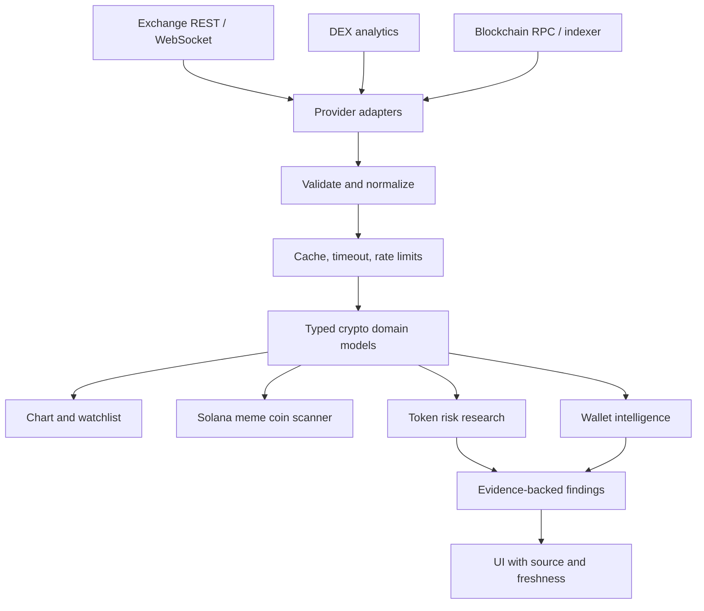

# Arsitektur Zabrina Alpha Terminal

## 1. Tujuan dan batasan

Zabrina Alpha Terminal adalah **terminal trading dan riset khusus cryptocurrency dengan fokus meme coin**. Arsitektur diarahkan pada market monitoring, charting, Solana-first token discovery, token risk research, on-chain wallet intelligence, dan trading analytics.

Dokumen ini mendefinisikan arsitektur target. Modul hanya boleh dianggap tersedia setelah kode, konfigurasi, serta pengujiannya benar-benar ada. Live order execution bukan asumsi default.

## 2. Stack dan struktur

- Next.js App Router untuk halaman dan route handlers.
- React dan TypeScript strict mode untuk UI serta kontrak data.
- Tailwind CSS v4 untuk styling.
- lightweight-charts untuk charting.
- Zustand untuk state UI bersama.
- REST/WebSocket/RPC/indexer adapter untuk data eksternal.

Struktur utama mengikuti direktori repository saat ini: `app/`, `components/`, `docs/`, serta file konfigurasi di root. Pertahankan struktur tanpa `src/` kecuali ada keputusan arsitektur yang disengaja.

## 3. Lapisan sistem

1. **Presentation:** chart, watchlist, scanner, detail token, wallet activity, risk findings, dan portfolio.
2. **Route handlers:** validasi request, pemanggilan provider server-side, respons API, cache, serta error mapping.
3. **Provider adapters:** exchange REST/WebSocket, DEX analytics, RPC/indexer, explorer, dan berita.
4. **Normalization/domain:** model token, chain, pair/pool, candle, market metrics, wallet event, dan risk finding.
5. **Analytics:** filter scanner, perhitungan perubahan harga, PnL, indikator risiko, dan ringkasan.
6. **Quality/security:** schema validation, tests, rate limits, timeouts, CI, serta provenance data.

## 4. Model data dan identitas

### Token

Identitas token harus memakai `chainId + mint/contract address`. Nama dan simbol hanya metadata tampilan, karena keduanya dapat duplikat atau menyesatkan.

### Pair/pool

Simpan atau normalisasikan chain, DEX, alamat pair/pool, alamat base token, alamat quote token, waktu pembuatan jika tersedia, serta sumber data. Jangan menggabungkan pair berbeda hanya karena simbol base token sama.

### Market metrics

Setiap metrik sebaiknya memiliki nilai, satuan, provider, timestamp sumber/penerimaan bila tersedia, dan status freshness. Bedakan dengan jelas:
- Harga terakhir vs candle historis.
- Spot vs perpetual.
- Volume vs likuiditas.
- Market cap vs fully diluted valuation (FDV).
- Data aktual vs estimasi.

### Risk finding

Setiap hasil pemeriksaan memiliki status `pass`, `warning`, `fail`, atau `unknown`, alasan, data bukti, sumber, waktu pemeriksaan, serta versi aturan bila relevan. `unknown` tidak berarti `pass`.

## 5. Modul domain

### 5.1 Crypto market terminal

- Chart menerima simbol dan timeframe yang divalidasi.
- Candle memiliki timestamp konsisten, nilai OHLC valid, serta urutan waktu yang benar.
- Streaming menangani disconnect, reconnect backoff, unsubscribe, dan cleanup.
- Data spot tidak boleh dilabeli perpetual, dan sebaliknya.
- Watchlist perlu menangani simbol tidak tersedia, data stale, dan kegagalan provider.

### 5.2 Solana-first meme coin scanner

Scanner mengambil kandidat token/pair dari provider yang disetujui, menormalkan metrik, menerapkan filter, dan menunjukkan sumber aslinya. Filter dapat mencakup umur pair, volume, likuiditas, transaksi, perubahan harga, dan market cap/FDV jika tersedia.

Hasil harus mempertahankan chain, mint address, pair address, DEX, timestamp, dan alasan masuk filter. Profil terbaru bukan daftar meme coin yang sudah terklasifikasi secara sempurna. Indikator awal bukan audit kontrak.

### 5.3 Token risk research

Solana dan EVM memerlukan aturan yang berbeda. Pemeriksaan dapat meliputi liquidity depth, holder concentration, authority/ownership, deployer activity, transfer restrictions, serta metadata atau contract behavior jika provider mendukungnya.

Setiap temuan harus menjelaskan apa yang benar-benar diperiksa dan apa yang belum dapat diperiksa. Hindari skor agregat yang menutupi satu risiko kritis.

### 5.4 Wallet intelligence

- Alamat dan chain wajib eksplisit.
- Klasifikasi transaksi harus membedakan swap, transfer, fee, bridge, dan internal transfer jika data mendukung.
- Realized dan unrealized PnL harus dipisahkan.
- Metodologi valuasi, fee, token spam, airdrop, transfer, dan histori yang hilang harus dijelaskan.
- Whale/early-buyer adalah pola aktivitas teramati, bukan prediksi harga atau identitas pemilik.

### 5.5 Trading intelligence

Alert, indikator, risk/reward, portfolio, jurnal, dan paper trading perlu menggunakan data yang dapat ditelusuri dan perhitungan yang diuji. Jika live execution dipertimbangkan, buat batas keamanan, konfirmasi eksplisit, kontrol ukuran order, audit trail, dan pemisahan kredensial sebagai desain tersendiri.

## 6. Provider adapter

Setiap adapter sebaiknya memiliki kontrak yang jelas untuk:
- Timeout dan cancellation.
- Validasi schema dan normalisasi error.
- HTTP 429 dan rate limits.
- Cache dan freshness.
- Retry terbatas dengan backoff.
- Sumber dan timestamp data.
- Pengujian terhadap payload valid, kosong, malformed, serta provider failure.

Gunakan endpoint resmi atau provider yang penggunaan datanya diizinkan. Jangan mengasumsikan endpoint publik bebas batas atau stabil selamanya.

## 7. Keamanan

- Tidak meminta atau menyimpan private key/seed phrase untuk fungsi riset.
- Server-side secret tidak boleh dikirim ke browser.
- Validasi semua input dan respons provider.
- Batasi ukuran respons, concurrency, dan request rate.
- Hindari SSRF dari URL pengguna dan unsafe HTML rendering.
- Jangan menyamarkan data stale sebagai live.
- Audit kalkulasi yang memengaruhi keputusan trading.
- Gunakan permission CI minimum dan tinjau dependency.

## 8. Pengujian

Prioritaskan unit/integration tests untuk:
- Parsing serta normalisasi candle dan timestamp.
- Validasi simbol, chain, mint/contract address, dan pair.
- Provider response: success, empty, malformed, timeout, 429, dan 5xx.
- Filter scanner dan sorting.
- Kalkulasi perubahan harga, volume, liquidity, serta PnL.
- Risk findings termasuk status unknown.
- WebSocket reconnect dan cleanup.
- Route handlers untuk query parameter tidak valid dan error provider.

## 9. Kontrak kualitas

Data eksternal yang gagal tidak boleh diganti dengan nilai contoh tanpa label. UI harus membedakan loading, empty, error, stale, dan data valid. Semua klaim real-time atau production-ready memerlukan bukti implementasi dan pengujian aktual.
