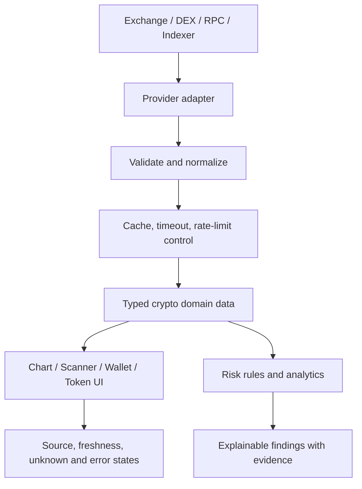

# Arsitektur Zabrina Alpha Terminal

## Tujuan

Zabrina Alpha Terminal adalah terminal riset **khusus cryptocurrency dan meme coin**. Arsitektur perlu memisahkan UI, normalisasi data pasar, integrasi provider, analisis on-chain, dan kalkulasi risiko agar hasil dapat diuji dan ditelusuri ke sumbernya.

Dokumen ini menjelaskan rancangan target; jangan menganggap integrasi sebagai tersedia sebelum kode dan pengujiannya ada.

## Lapisan aplikasi

1. **Routes dan layout — `app/`**: halaman terminal dan endpoint Next.js.
2. **Feature components — `components/`**: chart, watchlist, scanner, token detail, wallet view, alert, dan portfolio.
3. **Domain/data adapters — `lib/` atau modul domain terkait**: REST/WebSocket, RPC/indexer, parser, validasi, cache, dan normalisasi.
4. **Domain models**: token, chain, pair/pool, candle, trade, wallet activity, liquidity, dan risk findings dengan tipe eksplisit.
5. **State UI**: Zustand untuk state yang benar-benar dibagikan; data server tidak otomatis perlu masuk global store.
6. **Providers**: exchange, DEX analytics, blockchain RPC/indexer, explorer, dan sumber berita sesuai integrasi aktif.

## Aliran data

## Modul domain

### Market terminal

- Candle menggunakan satuan timestamp dan format harga yang konsisten.
- Simbol harus diikat ke exchange/market yang benar; simbol yang sama dapat mewakili aset berbeda di provider berbeda.
- Pisahkan spot dan perpetual data. Funding rate, open interest, liquidation, dan order book hanya ditampilkan jika provider benar-benar menyediakan data tersebut.
- Streaming harus menangani disconnect, reconnect backoff, unsubscribe, dan cleanup.

### Meme coin scanner

Setiap hasil scanner sebaiknya menyimpan:
- Chain ID dan alamat token/pair yang kanonis.
- DEX/pool dan timestamp pair dibuat, jika tersedia.
- Harga, liquidity, volume, jumlah transaksi, perubahan harga, market cap/FDV beserta sumbernya.
- Waktu pengambilan data dan indikator freshness.
- Status validasi serta alasan token masuk filter.

Jangan menggabungkan hasil dari jaringan atau pair berbeda hanya berdasarkan nama/simbol token. Gunakan alamat kontrak/mint dan chain sebagai identitas utama.

### On-chain wallet intelligence

- Simpan alamat dan jaringan secara eksplisit; alamat serupa pada chain berbeda bukan identitas yang sama.
- Bedakan transaksi swap, transfer, fee, bridge, dan transfer internal jika datanya mendukung.
- PnL memerlukan histori transaksi yang cukup, harga historis, biaya, dan perlakuan transfer yang terdokumentasi.
- Beri label estimasi/incomplete bila histori atau pricing tidak lengkap.
- Whale dan early buyer adalah deskripsi perilaku teramati, bukan bukti kemampuan memprediksi harga.

### Token risk engine

- Hasil tiap pemeriksaan harus berisi status `pass`, `warning`, `fail`, atau `unknown`, alasan, sumber, dan timestamp.
- Pemeriksaan berbeda antar-chain. Hindari menggunakan asumsi token EVM untuk token Solana atau sebaliknya.
- Risiko konsentrasi holder harus mengecualikan akun pool/burn/locker yang teridentifikasi hanya bila klasifikasinya dapat dibuktikan.
- Jangan menyatakan token aman hanya berdasarkan skor agregat.

## Prinsip provider dan data

- Gunakan API/RPC resmi atau provider dengan izin yang sesuai.
- Terapkan timeout, schema validation, batas ukuran respons, retry backoff, cache, dan penanganan HTTP 429.
- Hindari scraping yang melanggar ketentuan layanan.
- Jangan mengisi kegagalan provider dengan harga sintetis tanpa label demo.
- Tampilkan sumber, waktu pengambilan, satuan, serta status stale untuk data penting.

## Keamanan

- Jangan meminta seed phrase, private key, atau secret wallet untuk fungsi riset.
- Rahasia API tidak boleh masuk ke client bundle atau log.
- Jika kelak ada integrasi exchange untuk trading, gunakan API key minimal-permission, non-withdrawal, dan pemisahan jelas antara paper trading dan live trading.
- Validasi alamat, chain, simbol, dan parameter sebelum request.
- Hindari proxy URL arbitrer, sanitasi teks pihak ketiga, dan batasi request.
- Audit semua kalkulasi yang memengaruhi ukuran posisi atau keputusan risiko.

## Pengujian

Prioritaskan unit tests untuk:
- Normalisasi candle dan timestamp.
- Identitas token/pair lintas chain.
- Parsing respons provider, data kosong, malformed, timeout, dan rate limit.
- Kalkulasi perubahan harga, liquidity/volume metrics, serta realized/unrealized PnL.
- Klasifikasi transaksi wallet dan deteksi data yang tidak lengkap.
- Token-risk findings, termasuk status unknown.
- WebSocket reconnect dan cleanup.
